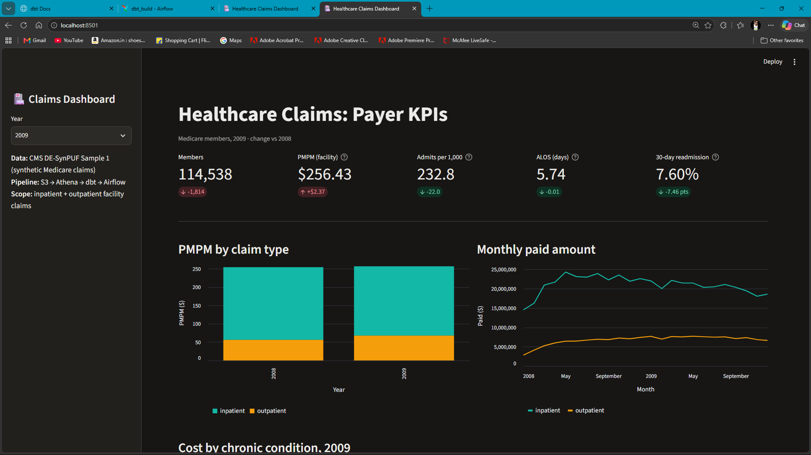
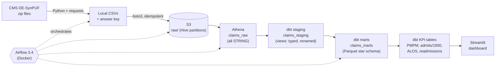
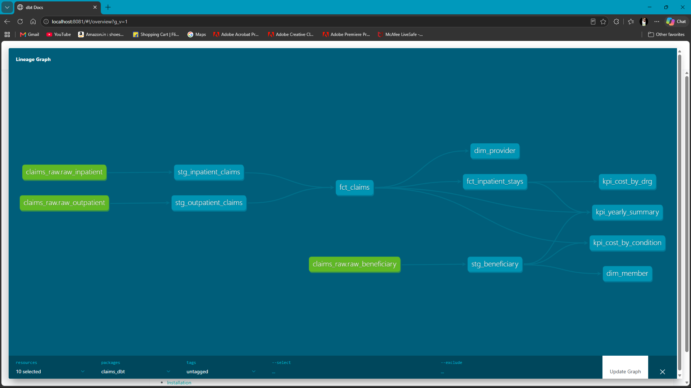
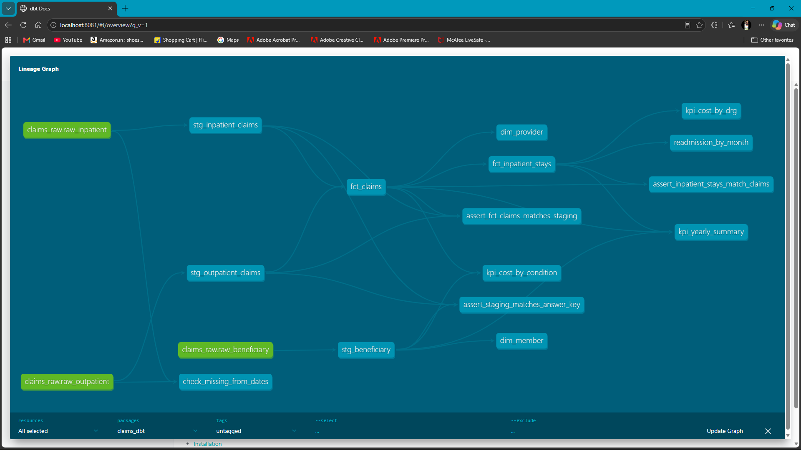
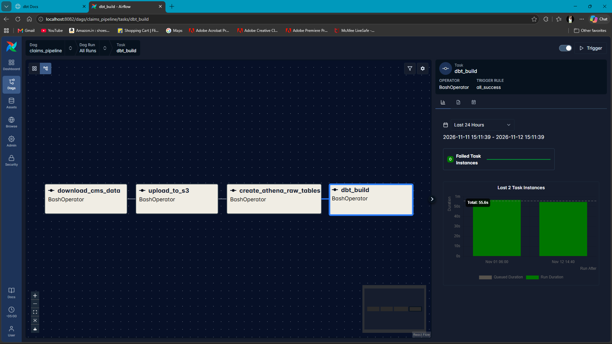
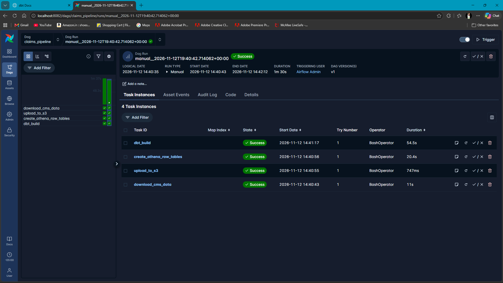

# Healthcare Claims Pipeline: CMS Medicare claims → S3 + Athena → dbt → Airflow → Streamlit

An end-to-end, payer-side data pipeline. It loads **857,563 synthetic Medicare claims** (CMS DE-SynPUF) into AWS, models them with **dbt** into a tested star schema, computes the KPIs a health plan runs on (**PMPM, admits per 1,000, ALOS, 30-day readmissions, cost by chronic condition and DRG**), orchestrates everything with **Airflow 3**, and serves the results in a **Streamlit** dashboard.

Every layer reconciles to the source files **to the cent**: $863,784,890.00 in, $863,784,890.00 out.



## The problem

Health plans (payers) run on claims. Leadership asks the same questions every month:

- What does one member cost us per month (**PMPM**)?
- How often do members go into hospital (**admits per 1,000**), and for how long (**ALOS**)?
- How many come back within 30 days (**readmission rate**)?
- Which chronic conditions and which kinds of hospital stay drive the spending?

The raw data does not answer these directly. The CMS files are plain CSV text, one hospital stay can be billed as several claim rows, some claims have no dates, and member coverage changes month by month. The numbers have to be correct before they are interesting, so this project treats **reconciliation and data-quality checks as first-class features**, not afterthoughts.

## Architecture



| Step | Tool | What it does |
| --- | --- | --- |
| 1. Download | Python, requests | Downloads 4 CMS zip files, validates them (`PK` header), unzips, and profiles every file into `answer_key.txt`: rows, unique members, unique claim keys, total paid, date range. |
| 2. Land | boto3, S3 | Uploads to `raw/<dataset>/`, with member files in Hive-style partitions (`raw/beneficiary/year=2008/`). Skips files already in S3 with the same size (`head_object`), so re-runs are safe. |
| 3. Raw tables | Athena | External tables over the CSVs, **every column as STRING** (OpenCSVSerde). Raw never fails to load, and bad values stay visible. Row counts and paid totals are checked against the answer key. |
| 4. Staging | dbt (views) | Types dates and money with reusable macros, renames columns to business names, sets the true grain (`claim_id + segment`), and recovers missing dates where another date exists. |
| 5. Marts | dbt (Parquet tables) | Star schema: `fct_claims`, `fct_inpatient_stays`, `dim_member`, `dim_provider`. |
| 6. KPIs | dbt (Parquet tables) | `kpi_yearly_summary`, `kpi_cost_by_condition`, `kpi_cost_by_drg`. |
| 7. Orchestration | Airflow 3.4, Docker | One DAG: download → upload → raw tables → `dbt build`, with retries, timeouts and a monthly schedule. |
| 8. Dashboard | Streamlit, PyAthena | Reads only the KPI and mart tables, cached for an hour, with year-over-year deltas and the data caveats next to the numbers they affect. |

**dbt lineage** (sources in green, models in blue):



## Data

[CMS DE-SynPUF](https://www.cms.gov/data-research/statistics-trends-and-reports/medicare-claims-synthetic-public-use-files/cms-2008-2010-data-entrepreneurs-synthetic-public-use-file-de-synpuf) Sample 1: synthetic Medicare claims built by CMS from real 2008–2010 data, so the structure is realistic but no real patient is in it.

| File | Rows | Columns | Notes |
| --- | --- | --- | --- |
| Beneficiary 2008 | 116,352 | 32 | One row per member per year |
| Beneficiary 2009 | 114,538 | 32 | |
| Inpatient claims 2008–2010 | 66,773 | 81 | 66,705 unique claim IDs: long stays are split into segments |
| Outpatient claims 2008–2010 | 790,790 | 76 | 779,815 unique claim IDs |

The 2010 beneficiary file for Sample 1 is not available (the CMS link returns 404). Member-based KPIs therefore cover **2008–2009**. 2010 claims are still used as the follow-up window for late-2009 readmissions.

## dbt models

| Layer | Model | Grain | Built as |
| --- | --- | --- | --- |
| Staging | `stg_beneficiary` | member + year | view |
| Staging | `stg_inpatient_claims` | claim_id + segment | view |
| Staging | `stg_outpatient_claims` | claim_id + segment | view |
| Marts | `fct_claims` | claim_type + claim_id + segment | Parquet table |
| Marts | `fct_inpatient_stays` | one hospital stay (segments combined) | Parquet table |
| Marts | `dim_member` | member | Parquet table |
| Marts | `dim_provider` | provider | Parquet table |
| KPIs | `kpi_yearly_summary` | year | Parquet table |
| KPIs | `kpi_cost_by_condition` | year + chronic condition | Parquet table |
| KPIs | `kpi_cost_by_drg` | DRG | Parquet table |

**Testing: 38 tests on 10 models.** A full `dbt build` ends with `PASS=47 WARN=1 ERROR=0` (the one warning is a documented data gap, explained below).

- `unique` and `not_null` on every grain key, `accepted_values` on codes, and `relationships` from every claim to `dim_member`.
- **A reconciliation chain**, so a dollar cannot be lost between layers:
  - `assert_staging_matches_answer_key`: staging row counts and paid totals equal the answer key from the source files.
  - `assert_fct_claims_matches_staging`: the fact table equals staging.
  - `assert_inpatient_stays_match_claims`: combining segments into stays gives exactly one row per claim ID, with the same total paid.
- **Threshold tests** for known gaps: warn while the count of undated claims stays at today's level, fail the pipeline if it grows.



## Results

### Yearly payer KPIs

| KPI | 2008 | 2009 |
| --- | --- | --- |
| Members | 116,352 | 114,538 |
| Member months | 1,303,587 | 1,300,350 |
| **PMPM (facility)** | **$254.06** | **$256.43** |
| PMPM inpatient | $197.95 | $188.78 |
| PMPM outpatient | $56.11 | $67.65 |
| Hospital admissions | 27,680 | 25,230 |
| **Admits per 1,000** | **254.8** | **232.8** |
| **ALOS (days)** | **5.75** | **5.74** |
| 30-day readmission rate | 15.06% | 7.60% (see findings) |

- Admits per 1,000 and ALOS fall in the typical Medicare range (about 200–400 and 4–7 days).
- **PMPM here is facility cost only** (inpatient + outpatient claims). It excludes physician (carrier) and drug (Part D) claims, which is why it is lower than an all-in Medicare PMPM.
- Inpatient claims are 7.8% of claim rows but **74% of spend**. From 2008 to 2009, spend shifts from inpatient to outpatient.

### Cost by chronic condition (2009)

| Condition | Members with it | PMPM with | PMPM without | × more expensive |
| --- | --- | --- | --- | --- |
| Kidney disease | 20.7% | $696.55 | $133.27 | 5.23 |
| Ischemic heart disease | 47.7% | $428.45 | $82.25 | 5.21 |
| Diabetes | 41.6% | $455.28 | $100.30 | 4.54 |
| Heart failure | 34.4% | $494.60 | $120.41 | 4.11 |

Members have several conditions at once, so these multipliers show **association, not cause**, and cannot be added together.

### Reconciliation

| Check | Source (answer key) | Pipeline |
| --- | --- | --- |
| Inpatient claim rows | 66,773 | 66,773 |
| Inpatient paid | $639,260,180.00 | $639,260,180.00 |
| Outpatient claim rows | 790,790 | 790,790 |
| Outpatient paid | $224,524,710.00 | $224,524,710.00 |
| Inpatient stays (unique claim IDs) | 66,705 | 66,705 |
| Members 2008 / 2009 | 116,352 / 114,538 | 116,352 / 114,538 |

## Data findings: investigated before reporting

| # | Finding | How it was found | What I did |
| --- | --- | --- | --- |
| 1 | **Claim ID is not unique.** 66,773 inpatient rows but 66,705 claim IDs: long stays are billed in segments. | Profiling in the download script | Grain set to `claim_id + segment`. Built `fct_inpatient_stays` (one row per stay) so a split stay is not counted as two admissions. |
| 2 | **68 inpatient claims had no from/thru date.** | A `not_null` test failed; `analyses/check_missing_from_dates.sql` showed both dates blank | Recovered all 68 from the admission and discharge dates (`coalesce`). The test is now strict. |
| 3 | **11,253 outpatient claims ($15.2M, 1.4%) have no dates at all.** | Same analysis | Kept, so totals still reconcile. Flagged (`is_missing_service_date`), excluded from yearly and monthly KPIs, guarded by a threshold test. |
| 4 | **Readmissions slide from about 17% to about 5%** over 2008–2009 while admissions stay flat. | A sanity check against typical Medicare rates, then `analyses/readmission_by_month.sql` | A smooth monthly slide, not a step, so it is not a code bug: it comes from how CMS synthesised the data. Documented in the dbt docs and on the dashboard instead of being reported as a finding. |
| 5 | **DRG spend is nearly flat** (top 10 DRGs about 0.5% of spend each, about $14k per stay). | Sanity check | CMS scrambles DRG codes in SynPUF. The model is correct; the ranking is not meaningful on this data. Documented. |
| 6 | **Claims before 2008** (from Nov 2007) and a low Jan–Mar 2008 in the monthly trend. | Profiling the date range | Yearly KPIs start from member months, so only 2008 and 2009 are reported. The early-2008 ramp is a period-boundary effect. |

## Design decisions

| Decision | Why |
| --- | --- |
| **S3 + Athena** instead of a database server | Serverless and pay-per-query: no cluster to run or pay for while idle. SQL directly over files in S3. |
| **Raw tables are all STRING** | Loading never fails on a bad value. Typing happens in dbt staging, where failures become visible, tested and fixable. |
| **Staging as views, marts as Parquet tables** | Staging is a thin, always-current layer. Marts are read repeatedly by the dashboard, so they are computed once and stored in a columnar format that Athena scans cheaply. |
| **Reusable macros** (`parse_date`, `to_amount`) | One definition of "how a CMS date or amount is parsed", used in every model. |
| **A separate stays fact** | Admissions, length of stay and readmissions are about stays, not billing segments. Different question, different grain. |
| **PMPM divides by member months** | A member covered for 6 months counts as 6, not 12, so years and groups compare fairly. |
| **Readmissions with `LEAD()`** | For each stay, the same member's next admission; readmitted when it is 0–30 days after discharge. |
| **Least-privilege IAM** | A dedicated `claims` user. Glue permissions are scoped to `claims*` databases only. No keys in code or in Git. |
| **Airflow with LocalExecutor, 4 containers** | The official setup uses Celery + Redis across 8 containers, which is unnecessary for one machine. |
| **dbt in its own virtualenv inside the Airflow image** | Airflow and dbt depend on many of the same libraries at different versions. Keeping them apart avoids conflicts. |
| **AWS credentials mounted read-only** into Airflow | Keys are never copied into the image or the repository. |
| **Idempotent tasks + retries** | Re-running skips work already done (the upload step takes under a second when S3 is current), so a retry never duplicates data. |
| **Business logic in dbt, not the dashboard** | Every KPI is defined and tested once in the warehouse. The dashboard only displays it. |

## Orchestration



A manual run of the full pipeline in Airflow took **1 min 30 s**, with every task succeeding on its first try:

| Task | Duration | Note |
| --- | --- | --- |
| `download_cms_data` | 11 s | Files already present, so it re-validates and re-profiles |
| `upload_to_s3` | 0.7 s | All 4 files already in S3 with the same size, so all skipped |
| `create_athena_raw_tables` | 20 s | Rebuilds raw tables and re-checks them against the answer key |
| `dbt_build` | 55 s | 10 models + 38 tests |



## Problems found and fixed

- **dbt-athena would not install on Python 3.14**: a dependency (`mmh3`) needed a C compiler. Fixed by running dbt in a separate Python 3.12 environment.
- **`AccessDenied: glue:GetTableVersions`** on the first `dbt run`: the IAM user only had what the Python scripts needed. Fixed with an inline policy scoped to the `claims*` Glue databases.
- **A one-letter typo (`mart:` instead of `marts:`)** in `dbt_project.yml` made dbt silently build the marts as views in the wrong database. Caught from dbt's "unused configuration paths" warning; fixed, and the stray views dropped.
- **Port clashes on Windows**: a local Mirth Connect install holds 8080, so dbt docs run on 8081 and Airflow on 8082.
- **Airflow 3 task authentication**: running tasks report back to the API server, so every component needs the same JWT secret. Set explicitly in the compose file.

## Repository layout

```
ingestion/download_data.py        download, validate, unzip, profile -> answer key
ingestion/upload_to_s3.py         idempotent upload to S3 with Hive-style partitions
athena/create_raw_tables.py       Athena raw tables + checks against the answer key
athena/*.sql                      the generated raw-table DDL
claims_dbt/models/staging/        3 staging views + sources + tests
claims_dbt/models/marts/          fact and dimension tables + tests
claims_dbt/models/marts/kpis/     KPI tables
claims_dbt/macros/                parse_date, to_amount
claims_dbt/tests/                 reconciliation tests
claims_dbt/analyses/              the data-quality investigations
airflow/                          Dockerfile, docker-compose.yml, dags/claims_pipeline.py
dashboard/app.py                  Streamlit dashboard
docs/                             screenshots used in this README
```

## How to run it

**Prerequisites:** an AWS account, the AWS CLI with a profile named `claims` (an IAM user with S3, Athena and Glue access), Python 3.12, and Docker Desktop. Replace the bucket name `chhatraband-claims-pipeline` with your own in `ingestion/upload_to_s3.py`, `athena/create_raw_tables.py`, `claims_dbt/profiles.yml` and `dashboard/app.py`.

1. **Ingest:** `python -m venv .venv`, activate it, `pip install -r requirements.txt`, then run `python ingestion/download_data.py`, `python ingestion/upload_to_s3.py` and `python athena/create_raw_tables.py`.
2. **Transform:** create a second environment (`py -3.12 -m venv .venv-dbt`), `pip install -r requirements-dbt.txt`, then from `claims_dbt/` run `dbt build`. Optionally `dbt docs generate` and `dbt docs serve --port 8081`.
3. **Orchestrate:** from `airflow/`, run `docker compose build`, `docker compose up airflow-init`, then `docker compose up -d`. Open http://localhost:8082 (login `airflow` / `airflow`), unpause `claims_pipeline` and trigger it.
4. **Dashboard:** create a third environment (`py -3.12 -m venv .venv-dash`), `pip install -r requirements-dashboard.txt`, then `streamlit run dashboard/app.py` and open http://localhost:8501.

## What I'd add next

- **Incremental models** and partitioning `fct_claims` by service year, so monthly loads only process new data.
- **DRG and diagnosis names** as dbt seeds, and ICD-9 diagnoses grouped into clinical categories.
- **Physician (carrier) and Part D drug claims**, for an all-in PMPM.
- **Risk adjustment** (HCC scores), so cost can be compared fairly across sicker and healthier members.
- **CI with GitHub Actions**: run `dbt build` against a dev schema on every pull request.
- **Event-driven scheduling**: trigger the DAG when new files land in S3, instead of a fixed monthly schedule.

## Data note

All data is the CMS DE-SynPUF **synthetic** dataset. No real patient information is used, and the `data/` folder is excluded from the repository.